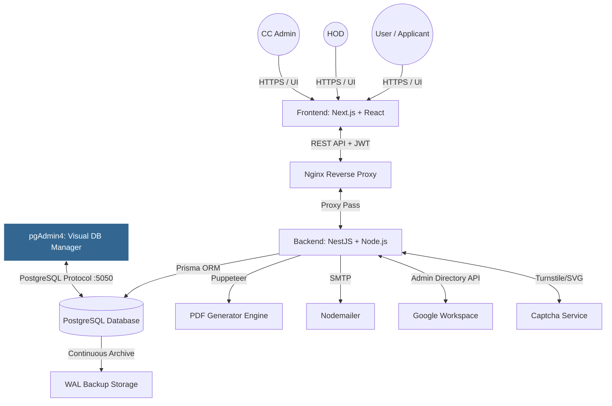

# BHU Email Portal — Master Architecture & Walkthrough

> [!IMPORTANT]
> This document is the **Ultimate End-to-End Blueprint** of the Banaras Hindu University (BHU) Email Provisioning Portal. It is designed for future developers and IT administrators to fully understand the folder structures, module interactions, data flows, and security protocols of the entire stack.

---

## 🏗️ 1. Full-Stack System Architecture



### 🗂️ Master Directory Structure

```
BHU-INTERNSHIP-PROJECT/
├── docker-compose.yml          ← Main deployment orchestration (includes pgAdmin visual DB manager)
├── backup.bat / backup.sh      ← Automated DB backup scripts
├── backend/                    ← NestJS Application (API Engine)
├── frontend/                   ← Next.js Application (User Interface)
├── pdf-generator/              ← HTML/CSS templates for Puppeteer
├── nginx/                      ← Reverse proxy routing & SSL configs
├── documents/                  ← Manuals, SOPs, and this walkthrough
└── backups/                    ← Automated SQL dumps & WAL archives
```

---

## ⚙️ 2. Backend (NestJS API) Deep Dive

The backend uses **NestJS**, an enterprise-level framework for Node.js, built on top of Express.

### Key Modules (`backend/src/modules/`)

1. **Auth Module (`auth/`)**: 
   - Handles login, JWT token generation, refresh tokens, and password hashing (using Argon2).
   - **Captcha Service:** Contains logic for generating SVG Captchas locally and verifying Cloudflare Turnstile for live environments.
2. **Users Module (`users/`)**: 
   - Handles registration, role-based access control (RBAC), and fetching user profiles.
3. **Applications Module (`applications/`)**: 
   - The core logic engine. Handles new email requests, file uploads (photos/signatures), HOD approvals, and CC Admin provisioning triggers.
4. **Google Workspace Module (`google-workspace/`)**: 
   - Uses Google's Admin SDK to automatically create `@bhu.ac.in` emails in the university's official Workspace without human intervention.
5. **PDF Generator Module (`pdf/`)**: 
   - Uses **Puppeteer** (Headless Chrome) to read the HTML templates from the `pdf-generator/` folder, inject user data, and render a pixel-perfect, print-ready A4 PDF.
6. **Analytics Module (`analytics/`)**: 
   - Aggregates database statistics (total applications, wait times, department breakdown) for the Admin Dashboard.

### Database Layer (`backend/prisma/`)
- Uses **Prisma ORM** for type-safe database queries.
- `schema.prisma`: Defines the PostgreSQL tables (User, Department, Application, Notification).
- `seed.ts`: Auto-populates the database with initial departments and dummy roles on first launch.

---

## 🖥️ 3. Frontend (Next.js) Deep Dive

The frontend is a **Next.js 16 (App Router)** Single Page Application using **Zustand** for state and **TailwindCSS v4** for styling.

### App Router Structure (`frontend/src/app/`)
- **Landing (`/`)**: Public homepage.
- **Auth (`/login`, `/register`)**: JWT-based authentication forms with SVG Captcha integration.
- **Dashboards (`/dashboard/`)**:
  - `applicant/`: For students to submit and track applications.
  - `hod/`: For Heads of Departments to bulk approve/reject applications.
  - `admin/`: For Computer Center admins to trigger Google Workspace provisioning and view analytics.

### Global State & API (`frontend/src/lib/`)
- **`axios.ts`**: The central HTTP client. It intercepts every request to attach the JWT token and automatically handles 401 Unauthorized errors by calling the refresh token endpoint seamlessly.
- **`store.ts`**: A Zustand store that persists the user's session (name, role, tokens) in the browser's `localStorage`.

### Reusable UI (`frontend/src/components/`)
- Contains highly modular components: `Button`, `Input`, `Modal`, `StatusBadge`, `Timeline`, and a custom `Toast` notification system.

---

## 🛡️ 4. Security, Backups & Disaster Recovery

### Hybrid Captcha System
- **SVG Captcha:** Currently active. Generates a case-insensitive image with visual noise directly from the backend. Ideal for Intranet deployments where external internet access is blocked.
- **Cloudflare Turnstile:** Ready for Live deployments. Code is commented out but fully written. Provides invisible bot protection.

### 0-Data Loss Backup Strategy
1. **Automated Dumps:** `backup.bat` and `backup.sh` scripts can be attached to Windows Task Scheduler / Linux Cron to generate daily `.sql` dumps.
2. **Synchronous WAL Archiving:** The `docker-compose.yml` configures Postgres to write WAL logs every 60 seconds to `backups/archive/`. If the server hardware burns down, maximum data loss is 1 minute.
3. **Password Security:** Uses Argon2 (Winner of Password Hashing Competition) to store credentials.

---

## 🔄 5. End-to-End Application Lifecycle (Working Flow)

1. **Submission:** Student registers, selects department, fills details, uploads a photo, and submits. Application status becomes `PENDING_HOD`.
2. **HOD Approval:** HOD logs in, reviews the data, and clicks "Approve". Status becomes `APPROVED_HOD` (or `PENDING_CC`).
3. **Provisioning:** CC Admin clicks "Provision". Backend calls the **Google Workspace API**, creates the `@bhu.ac.in` account, and generates a temporary password.
4. **Fulfillment:** Backend calls the **PDF Module**, generates the official digitally signed document, and emails both the PDF and the Google credentials to the student via **Nodemailer**. Status becomes `PROVISIONED`.

---

## 🚀 6. Future Advancements & Roadmap

For future developers taking over this project, here are the recommended logical next steps for scaling:

### A. Advanced Integrations
- **Samarth ERP / UET Integration:** Connect the registration page directly to BHU's central Samarth database using an API bridge so student details (Enrollment No., Name) are auto-verified against their fee receipts, removing the need for manual HOD verification.
- **Active Directory / LDAP:** Integrate backend authentication with BHU's existing Active Directory so staff members don't need to create new passwords.

### B. Scalability & Architecture
- **Queueing System (Redis / RabbitMQ):** Currently, PDF generation and Email sending are handled synchronously or in simple promises. Moving them to a Redis BullMQ queue will prevent the server from timing out during heavy bulk-approvals.
- **Streaming Replication:** Set up a hot-standby PostgreSQL server on a different physical machine to achieve absolute 0-second data loss mirroring.

### C. UI/UX Enhancements
- **Progressive Web App (PWA):** Add a `manifest.json` and service worker to the Next.js frontend so students and HODs can install the portal as a native app on their smartphones.
- **Multi-lingual Support (i18n):** Implement `next-intl` to allow toggling the entire interface between Hindi and English seamlessly.
