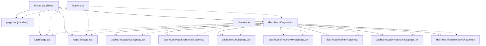
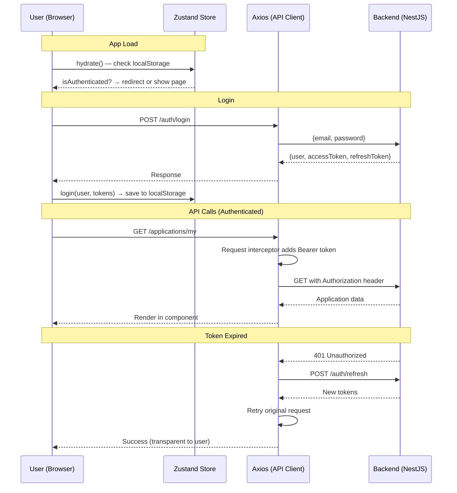

# BHU Email Portal — Complete Frontend Walkthrough

> [!NOTE]
> This document explains **every file** in the frontend, line-by-line, what it renders on screen, and how it connects to other files.

---

## 🗂️ Project Architecture Overview



### File Tree

```
frontend/
├── package.json              ← Dependencies & scripts
├── next.config.ts            ← Next.js config
├── tsconfig.json             ← TypeScript config
├── postcss.config.mjs        ← PostCSS (TailwindCSS v4)
├── src/
│   ├── app/
│   │   ├── globals.css       ← Design system tokens & animations
│   │   ├── layout.tsx        ← Root layout (fonts, metadata, toast)
│   │   ├── page.tsx          ← Landing page (/)
│   │   ├── login/page.tsx    ← Login page (/login)
│   │   ├── register/page.tsx ← Registration page (/register)
│   │   └── dashboard/
│   │       ├── layout.tsx    ← Dashboard shell (sidebar + topbar)
│   │       ├── applicant/
│   │       │   ├── page.tsx  ← My Applications list
│   │       │   └── new/page.tsx ← New Application form
│   │       ├── hod/
│   │       │   ├── page.tsx  ← Pending Reviews queue
│   │       │   └── reviewed/page.tsx ← Reviewed history
│   │       └── admin/
│   │           ├── page.tsx  ← Provisioning Queue
│   │           ├── analytics/page.tsx ← Analytics dashboard
│   │           └── users/page.tsx     ← User management
│   ├── components/
│   │   ├── Button.tsx        ← Reusable button
│   │   ├── Input.tsx         ← Reusable input field
│   │   ├── Modal.tsx         ← Reusable modal dialog
│   │   ├── StatsCard.tsx     ← Stats/metric card
│   │   ├── StatusBadge.tsx   ← Application status pill
│   │   ├── Timeline.tsx      ← Application progress timeline
│   │   └── Toast.tsx         ← Toast notification system
│   └── lib/
│       ├── axios.ts          ← HTTP client (Axios)
│       └── store.ts          ← Auth state (Zustand)
```

---

## 1. Configuration Files

---

### 1.1 [package.json](file:///c:/Users/harid/OneDrive/Desktop/BHU-INTERNSHIP-PROJECT/frontend/package.json)

**What it does:** Declares the project identity, scripts, and all dependencies.

| Line | Code | Explanation |
|------|------|-------------|
| 2 | `"name": "frontend"` | npm package name for this project |
| 3 | `"version": "0.1.0"` | Semantic version number |
| 4 | `"private": true` | Prevents accidental publishing to npm registry |
| 6 | `"dev": "next dev"` | Starts the local dev server with hot-reload (what you run with `npm run dev`) |
| 7 | `"build": "next build"` | Creates an optimized production build |
| 8 | `"start": "next start"` | Serves the production build |
| 9 | `"lint": "eslint"` | Runs the linter to check code quality |
| 12 | `"axios": "^1.17.0"` | HTTP client library for API calls to the backend |
| 13 | `"next": "16.2.7"` | The Next.js framework (App Router) |
| 14–15 | `"react": "19.2.4"` | React & React-DOM for UI rendering |
| 16 | `"zustand": "^5.0.14"` | Lightweight state management (used for auth) |
| 19 | `"@tailwindcss/postcss"` | TailwindCSS v4 PostCSS plugin |
| 25 | `"tailwindcss": "^4"` | TailwindCSS v4 for utility-first CSS classes |

**Frontend effect:** This file doesn't render anything visually, but it determines which libraries are available. If a dependency is missing here, the entire app fails to start.

---

### 1.2 [next.config.ts](file:///c:/Users/harid/OneDrive/Desktop/BHU-INTERNSHIP-PROJECT/frontend/next.config.ts)

**What it does:** Next.js build configuration. Currently empty (uses defaults).

| Line | Code | Explanation |
|------|------|-------------|
| 1 | `import type { NextConfig } from "next"` | TypeScript type import for config shape |
| 3–5 | `const nextConfig: NextConfig = {}` | Empty config object — uses all Next.js defaults |
| 7 | `export default nextConfig` | Exports so Next.js can read it |

**Frontend effect:** No visible effect. If you needed to configure image domains, redirects, or environment variables, you'd add them here.

---

### 1.3 [tsconfig.json](file:///c:/Users/harid/OneDrive/Desktop/BHU-INTERNSHIP-PROJECT/frontend/tsconfig.json)

**What it does:** Configures the TypeScript compiler.

| Line | Code | Explanation |
|------|------|-------------|
| 3 | `"target": "ES2017"` | Compiles to ES2017 JavaScript (supports async/await natively) |
| 4 | `"lib": ["dom", "dom.iterable", "esnext"]` | Makes browser APIs (document, window) and modern JS features available |
| 7 | `"strict": true` | Enables strict type checking (catches more bugs) |
| 8 | `"noEmit": true` | TypeScript only checks types; Next.js handles actual compilation |
| 11 | `"moduleResolution": "bundler"` | Uses modern bundler-style module resolution |
| 14 | `"jsx": "react-jsx"` | Uses the modern JSX transform (no need to `import React`) |
| 21–23 | `"paths": { "@/*": ["./src/*"] }` | **Path alias** — lets you write `@/components/Button` instead of `../../components/Button` |

**Frontend effect:** No visible effect. Controls how TypeScript interprets your code. The `@/*` alias is critical — it's used in every import like `@/lib/axios`, `@/components/Button`, etc.

---

### 1.4 [postcss.config.mjs](file:///c:/Users/harid/OneDrive/Desktop/BHU-INTERNSHIP-PROJECT/frontend/postcss.config.mjs)

**What it does:** Tells PostCSS to use TailwindCSS v4 for processing CSS.

| Line | Code | Explanation |
|------|------|-------------|
| 2–3 | `plugins: { "@tailwindcss/postcss": {} }` | Registers the TailwindCSS PostCSS plugin — this is what converts Tailwind classes like `bg-primary`, `rounded-xl` into actual CSS |

**Frontend effect:** Without this, none of the Tailwind utility classes (`flex`, `bg-primary`, `text-sm`, etc.) would work. Every styled element on every page depends on this.

---

## 2. Design System — [globals.css](file:///c:/Users/harid/OneDrive/Desktop/BHU-INTERNSHIP-PROJECT/frontend/src/app/globals.css)

**What it does:** Defines the entire visual identity of the app — colors, shadows, animations, and base styles.

**📍 Where it's used:** Imported in [layout.tsx](file:///c:/Users/harid/OneDrive/Desktop/BHU-INTERNSHIP-PROJECT/frontend/src/app/layout.tsx#L4) → applies to **every page** in the app.

### Lines 1: TailwindCSS Import
```css
@import "tailwindcss";
```
Imports TailwindCSS v4's base styles, reset, and utility generator.

### Lines 8–43: CSS Custom Properties (`:root`)
These are **design tokens** — the color palette of the entire app.

| Variable | Value | What it colors |
|----------|-------|----------------|
| `--background` | `#FCF9F8` | Page background (warm off-white) |
| `--foreground` | `#1C1B1F` | All body text |
| `--primary` | `#6750A4` | Main brand color (purple) — buttons, links, active states |
| `--primary-light` | `#7F67BE` | Lighter purple variant |
| `--primary-dark` | `#4F378B` | Darker purple for hover states |
| `--primary-container` | `#EADDFF` | Light purple backgrounds (badges, selected items) |
| `--on-primary` | `#FFFFFF` | Text on top of primary color |
| `--secondary` | `#625B71` | Secondary UI elements (HOD role badge) |
| `--tertiary` | `#7D5260` | Tertiary accent (CC Admin role, decorative) |
| `--surface` | `#FFFBFE` | Card/panel backgrounds |
| `--surface-variant` | `#E7E0EC` | Slightly tinted surfaces (hover backgrounds) |
| `--outline` | `#79747E` | Muted text, icons, borders |
| `--error` | `#B3261E` | Error states (red) |
| `--success` | `#1B873E` | Success states (green) |
| `--warning` | `#E6A817` | Warning states (amber) |
| `--shadow-1/2/3` | box-shadows | Three elevation levels for card depth |
| `--radius` | `8px` | Default border radius |

### Lines 45–70: `@theme inline` Block
Maps CSS variables into **Tailwind color tokens**. This is what makes `bg-primary`, `text-success`, `border-outline-variant` etc. work as Tailwind classes.

### Lines 72–78: Body Base Styles
```css
body {
  background: var(--background);   /* warm off-white */
  color: var(--foreground);        /* dark text */
  font-family: 'Inter', system-ui; /* modern sans-serif */
  line-height: 1.6;                /* comfortable reading */
}
```

### Lines 80–90: Custom Scrollbar
Makes the scrollbar thin (6px) with rounded thumb styled in the design system colors.

### Lines 92–130: Animations
| Animation | Effect | Used By |
|-----------|--------|---------|
| `fadeIn` | Fades in + slides up 8px | `.animate-fade-in` — used on page loads, error messages |
| `slideInRight` | Fades in + slides from right 16px | `.animate-slide-in` — used on toast notifications |
| `pulse-dot` | Pulsing opacity | `.animate-pulse-dot` — timeline active step indicator |
| `shimmer` | Moving gradient | `.skeleton` — loading placeholder effect |

---

## 3. Root Layout — [layout.tsx](file:///c:/Users/harid/OneDrive/Desktop/BHU-INTERNSHIP-PROJECT/frontend/src/app/layout.tsx)

**What it does:** The outermost wrapper for the **entire application**. Sets up fonts, metadata, and the global toast system.

**📍 Frontend effect:** This file wraps every single page. Whatever you see in `<html>` and `<body>` tags comes from here.

### Line-by-line:

| Lines | Code | Explanation |
|-------|------|-------------|
| 1 | `import type { Metadata }` | Type for SEO metadata |
| 2 | `import { Source_Serif_4, Inter }` | Imports **two Google Fonts** via Next.js font optimization |
| 3 | `import ToastContainer` | Imports the toast notification renderer |
| 4 | `import "./globals.css"` | **Loads the entire design system** (colors, animations) |
| 6–11 | `const sourceSerif = Source_Serif_4(...)` | Configures the **serif font** (used for headings) with CSS variable `--font-serif` |
| 13–18 | `const inter = Inter(...)` | Configures the **sans-serif font** (used for body text) with CSS variable `--font-geist-sans` |
| 20–25 | `export const metadata` | **SEO metadata** — sets the browser tab title to "BHU Email Portal — Banaras Hindu University" and meta description for search engines |
| 33–35 | `<html lang="en" className={...}>` | Sets language to English, applies both font CSS variables and `antialiased` text rendering |
| 37–41 | `<link rel="stylesheet" href="...Material+Symbols...">` | Loads **Google Material Symbols** icon font — every icon in the app (school, mail, check_circle, etc.) comes from this |
| 43 | `<body className="...bg-background text-foreground">` | Full-height body with design system background & text colors |
| 44 | `{children}` | **This is where every page renders** — the current route's content gets injected here |
| 45 | `<ToastContainer />` | Renders the global toast notification container (bottom-right corner of screen) |

---

## 4. Library Files

---

### 4.1 [lib/store.ts](file:///c:/Users/harid/OneDrive/Desktop/BHU-INTERNSHIP-PROJECT/frontend/src/lib/store.ts) — Auth State Management

**What it does:** Manages the logged-in user's session using **Zustand** (a lightweight React state management library). Persists auth data in `localStorage` so the user stays logged in across page refreshes.

**📍 Used by:** Landing page, login, register, dashboard layout, and new application form.

### Line-by-line:

| Lines | Code | Explanation |
|-------|------|-------------|
| 1 | `import { create } from "zustand"` | Imports Zustand's store creator |
| 3–11 | `export interface User` | Defines the shape of a user object: `id`, `email`, `bhuEmail` (nullable), `firstName`, `lastName`, `role` (APPLICANT/HOD/CC_ADMIN), `departmentId` |
| 13–22 | `interface AuthState` | Defines the full store shape: `user`, `accessToken`, `isAuthenticated`, `isLoading`, and three actions: `login`, `logout`, `hydrate` |
| 30–68 | `export const useAuthStore = create<AuthState>(...)` | Creates the Zustand store with initial state and actions |

### Store Actions:

| Action | What it does | Frontend Effect |
|--------|-------------|-----------------|
| **`login(user, accessToken, refreshToken)`** (L36–41) | Saves tokens + user to `localStorage`, updates state to authenticated | After login API call succeeds, this stores the session. Every subsequent page can check `isAuthenticated` |
| **`logout()`** (L43–48) | Removes all tokens from `localStorage`, resets state | Clicking the logout button clears everything and forces redirect to `/login` |
| **`hydrate()`** (L50–67) | Checks `localStorage` for existing session on app load | On every page load/refresh, this runs to restore the session without requiring re-login. `isLoading` starts as `true` and becomes `false` after hydration — this prevents a flash of unauthenticated content |

---

### 4.2 [lib/axios.ts](file:///c:/Users/harid/OneDrive/Desktop/BHU-INTERNSHIP-PROJECT/frontend/src/lib/axios.ts) — HTTP Client

**What it does:** Creates a pre-configured Axios instance that handles JWT authentication, token refresh, and API base URL.

**📍 Used by:** Every page that communicates with the backend (login, register, all dashboard pages).

### Line-by-line:

| Lines | Code | Explanation |
|-------|------|-------------|
| 12–18 | `const api = axios.create(...)` | Creates an Axios instance with: `baseURL` pointing to `http://localhost:4000/api/v1` (NestJS backend), `withCredentials: true` (sends cookies), and JSON content type |
| 21–32 | **Request Interceptor** | Before every API request, checks `localStorage` for `accessToken` and attaches it as `Authorization: Bearer <token>` header. This is how the backend knows who is making the request |
| 35–67 | **Response Interceptor** | After every API response, if it gets a `401 Unauthorized`: (1) takes the `refreshToken` from localStorage, (2) calls `/auth/refresh` to get a new access token, (3) retries the original request. If refresh fails, clears session and redirects to `/login` |

**Frontend effect:** You never see this file directly, but without it, no API calls would work. Every `api.get(...)` and `api.post(...)` call in the app goes through this.

---

## 5. Reusable Components

---

### 5.1 [Button.tsx](file:///c:/Users/harid/OneDrive/Desktop/BHU-INTERNSHIP-PROJECT/frontend/src/components/Button.tsx)

**What it does:** A reusable button component with 4 visual variants and 3 sizes.

**📍 Renders as:** Buttons throughout the app — "Sign In", "Register Now", "Submit Application", "Provision", "Approve", etc.

| Lines | Code | Explanation |
|-------|------|-------------|
| 1 | `"use client"` | Marks this as a client component (runs in browser, not server) |
| 5–10 | `interface ButtonProps` | Extends native button HTML attributes. Adds: `variant` (filled/outlined/text/tonal), `size` (sm/md/lg), `icon` (Material Symbol name), `loading` (shows spinner) |
| 26–27 | `const base = "inline-flex items-center..."` | Base CSS classes every button gets: flex layout, centered content, rounded corners, focus ring, disabled styling |
| 29–37 | `const variants = {...}` | **filled**: Purple bg, white text, shadow. **outlined**: Purple border, no bg. **text**: No bg, no border. **tonal**: Light purple bg |
| 39–43 | `const sizes = {...}` | **sm**: Small padding. **md**: Medium. **lg**: Large |
| 51–54 | Loading spinner | When `loading=true`, shows a spinning `progress_activity` Material icon instead of the normal icon |
| 55–56 | Icon rendering | If `icon` prop is provided, renders a Material Symbols icon before the button text |

**Visual Example:**
- **Filled** (primary action): Purple background, white text → "Sign In", "Submit Application"
- **Outlined** (secondary action): Purple border, transparent bg → "Cancel", "Back"
- **Tonal** (soft action): Light purple bg → "Bulk Approve"

---

### 5.2 [Input.tsx](file:///c:/Users/harid/OneDrive/Desktop/BHU-INTERNSHIP-PROJECT/frontend/src/components/Input.tsx)

**What it does:** A styled input field with a **floating label** effect and optional icon prefix.

**📍 Renders as:** Every text input on login, register, and application forms.

| Lines | Code | Explanation |
|-------|------|-------------|
| 5–9 | `interface InputProps` | Extends native input attributes. Adds: `label` (floating label text), `error` (error message), `icon` (Material icon name) |
| 23 | `const inputId = id \|\| label.toLowerCase()...` | Auto-generates an HTML `id` from the label for accessibility |
| 28–31 | Icon prefix | If `icon` is provided, renders a Material icon absolutely positioned inside the input's left side |
| 33–44 | `<input>` | The actual input element with: rounded borders, transparent placeholder (for floating label trick), focus ring on primary color, conditional left padding if icon exists, red border if error |
| 45–57 | `<label>` | The **floating label** — uses CSS `peer` selectors to: sit in the middle when empty, float to the top when focused or has value, change to primary color when focused |
| 59–64 | Error message | If `error` prop is set, shows a red error icon + message below the input |

**How the floating label works:**
1. The `<input>` has `placeholder-transparent` — placeholder is invisible but still occupies space
2. The `<label>` uses `peer-placeholder-shown` to detect if input is empty → label sits in the center
3. When the user focuses or types, `peer-focus` / `peer-not-placeholder-shown` triggers → label animates to the top, shrinks, and turns purple

---

### 5.3 [Modal.tsx](file:///c:/Users/harid/OneDrive/Desktop/BHU-INTERNSHIP-PROJECT/frontend/src/components/Modal.tsx)

**What it does:** A full-screen overlay dialog with backdrop blur, header, scrollable body, and optional footer.

**📍 Renders as:** Application detail popups, approve/reject dialogs, user detail views.

| Lines | Code | Explanation |
|-------|------|-------------|
| 5–12 | `interface ModalProps` | Props: `isOpen`, `onClose`, `title`, `children`, `size` (sm/md/lg/xl), `footer` (action buttons) |
| 24–33 | Body scroll lock | When modal opens, `document.body.style.overflow = "hidden"` prevents background scrolling. Cleaned up on close |
| 35–41 | Escape key handler | Pressing `Escape` calls `onClose` to dismiss the modal |
| 43 | `if (!isOpen) return null` | If closed, renders nothing at all (no DOM elements) |
| 53–58 | Overlay click | Clicking the dark backdrop (outside the modal content) closes it |
| 61 | Backdrop | `bg-black/40 backdrop-blur-sm` — semi-transparent black overlay with blur effect |
| 64–65 | Content card | White rounded card with shadow, constrained by `sizeClasses` max-width |
| 68–85 | Header | Title in serif font + close "X" button |
| 88 | Body | Scrollable area (`max-h-[70vh]`) for the modal's content |
| 91–95 | Footer | Right-aligned action buttons with subtle background |

---

### 5.4 [StatsCard.tsx](file:///c:/Users/harid/OneDrive/Desktop/BHU-INTERNSHIP-PROJECT/frontend/src/components/StatsCard.tsx)

**What it does:** A card showing a metric with an icon, label, big number value, and optional trend indicator.

**📍 Renders as:** Dashboard stats like "In Queue: 5", "Total Applications: 42", "Provisioned: 30".

| Lines | Code | Explanation |
|-------|------|-------------|
| 5–13 | `interface StatsCardProps` | Props: `icon`, `label`, `value`, `subtitle`, `trend` (up/down/neutral), `trendValue`, `variant` (changes icon color) |
| 15–36 | `variantStyles` | Maps each variant to background + text color for the icon circle. E.g., `primary` → purple container bg + purple icon, `success` → green container + green icon |
| 54–55 | Card container | White rounded card with border, subtle hover shadow |
| 56–75 | Top row | Icon circle on the left. If `trend` is provided, shows trending arrow + value on the right |
| 77–78 | Label | Small uppercase muted text: "TOTAL APPLICATIONS" |
| 80 | Value | Large bold number: "42" |
| 81–83 | Subtitle | Optional small muted text below the value |

---

### 5.5 [StatusBadge.tsx](file:///c:/Users/harid/OneDrive/Desktop/BHU-INTERNSHIP-PROJECT/frontend/src/components/StatusBadge.tsx)

**What it does:** A color-coded pill showing an application's current workflow status.

**📍 Renders as:** Status pills next to application entries: "PENDING HOD" (yellow), "APPROVED HOD" (purple), "PROVISIONED" (green), etc.

| Lines | Code | Explanation |
|-------|------|-------------|
| 10–18 | `statusConfig` | Maps each status string to its visual config: |

| Status | Color | Icon | Meaning |
|--------|-------|------|---------|
| `DRAFT` | Gray | edit_note | Not yet submitted |
| `PENDING_HOD` | Yellow/amber | hourglass_top | Waiting for HOD review |
| `APPROVED_HOD` | Purple | check_circle | HOD approved |
| `REJECTED_HOD` | Red | cancel | HOD rejected |
| `PENDING_CC` | Secondary | pending | Waiting for CC Admin |
| `PROVISIONED` | Green | verified | Email account created |
| `FAILED_PROVISIONING` | Red | error | Provisioning failed |

| Lines | Code | Explanation |
|-------|------|-------------|
| 31 | `const label = status.replace(/_/g, " ")` | Converts `PENDING_HOD` → `PENDING HOD` for display |
| 34–41 | Rendering | A rounded pill with icon + text, colored according to the status |

---

### 5.6 [Timeline.tsx](file:///c:/Users/harid/OneDrive/Desktop/BHU-INTERNSHIP-PROJECT/frontend/src/components/Timeline.tsx)

**What it does:** A vertical progress timeline showing the stages of an application. Has two exports:
1. `Timeline` component — renders the visual timeline
2. `buildTimelineSteps()` — helper function that converts a status string into timeline step data

**📍 Renders as:** The "Application Progress" section in the applicant's application detail modal.

### Timeline Component (L44–91):

Each step renders as:
- A **dot** (circle with icon) — green check for completed, purple pulse for active, gray for pending, red X for error
- A **connecting line** between dots
- **Label text** with optional description and date

### buildTimelineSteps() Helper (L97–208):

Converts a status like `"PENDING_HOD"` into 4 steps:

| Step | Label | When Completed |
|------|-------|---------------|
| 1 | Application Submitted | Always (if any status beyond DRAFT) |
| 2 | HOD Review | If status ≥ APPROVED_HOD |
| 3 | CC Admin Processing | If status ≥ PROVISIONED |
| 4 | Account Provisioned | If status = PROVISIONED |

Special cases: `REJECTED_HOD` → step 2 shows error. `FAILED_PROVISIONING` → step 3 shows error.

---

### 5.7 [Toast.tsx](file:///c:/Users/harid/OneDrive/Desktop/BHU-INTERNSHIP-PROJECT/frontend/src/components/Toast.tsx)

**What it does:** A toast notification system with its own Zustand store. Shows temporary messages that auto-dismiss.

**📍 Renders as:** Bottom-right corner notifications — "Application submitted successfully!", "Provisioning failed", etc.

| Lines | Code | Explanation |
|-------|------|-------------|
| 6–11 | `interface ToastData` | Each toast has: `id`, `message`, `variant` (success/error/warning/info), optional `duration` |
| 19–27 | `useToastStore` | Separate Zustand store for toasts. `addToast` generates a unique ID and appends. `removeToast` filters it out |
| 29–54 | `variantConfig` | Maps variants to colors: success=green, error=red, warning=amber, info=purple |
| 56–85 | `ToastItem` | Individual toast: icon + message + close button. Sets a timer (`setTimeout`) to auto-remove after `duration` (default 4s) |
| 87–99 | `ToastContainer` | Fixed to bottom-right (`fixed bottom-6 right-6 z-[100]`). Renders all active toasts stacked vertically |

**How to use from any page:**
```tsx
const { addToast } = useToastStore();
addToast({ message: "Success!", variant: "success" });
```

---

## 6. Pages

---

### 6.1 [page.tsx](file:///c:/Users/harid/OneDrive/Desktop/BHU-INTERNSHIP-PROJECT/frontend/src/app/page.tsx) — Landing Page (`/`)

**What it does:** The home page. If authenticated, redirects to the appropriate dashboard. If not, shows a hero section with CTA buttons.

**📍 Renders as:** The first page users see at `http://localhost:3000/`

#### Auth Redirect Logic (L11–32):
1. On mount, calls `hydrate()` to check localStorage for existing session
2. If authenticated, uses `switch(user.role)` to redirect:
   - `HOD` → `/dashboard/hod`
   - `CC_ADMIN` → `/dashboard/admin`
   - Default (APPLICANT) → `/dashboard/applicant`

#### Visual Sections:

**Navigation Bar** (L37–69):
- Fixed to top, semi-transparent with `backdrop-blur-md`
- Left: Purple icon square with "school" icon + "BHU Email Portal" / "Banaras Hindu University"
- Right: "Sign In" (text link) + "Register" (filled button)

**Hero Section** (L72–186):
- Background: Three large gradient circles (decorative, not interactive)
- Badge: "Official University Portal" with verified icon
- Heading: "Institutional Email Registration Portal" with gradient text effect
- Subtitle: Description of the @bhu.ac.in email service
- CTA buttons: "Register Now" (filled) + "Sign In" (outlined)
- Three **feature cards** at the bottom:
  1. "Digital Application" — description icon, primary color
  2. "Multi-Level Approval" — verified_user icon, secondary color
  3. "Auto Provisioning" — speed icon, tertiary color

**Footer** (L189–194): Copyright notice.

---

### 6.2 [login/page.tsx](file:///c:/Users/harid/OneDrive/Desktop/BHU-INTERNSHIP-PROJECT/frontend/src/app/login/page.tsx) — Login Page (`/login`)

**What it does:** Email + password login form. On success, stores the session and redirects to the user's dashboard.

**📍 Renders as:** Split-screen layout at `http://localhost:3000/login`

#### State Management (L22–25):
- `email`, `password` — form field values
- `error` — error message string
- `loading` — submit button loading state

#### Auth Flow (L51–69):
1. `e.preventDefault()` stops page reload
2. Calls `api.post("/auth/login", { email, password })`
3. On success: calls `login()` from Zustand store (saves tokens), then `redirectByRole()`
4. On error: shows the API error message (or fallback)

#### Visual Layout:

**Left Panel** (L74–117, hidden on mobile):
- Purple gradient background
- University emblem (school icon in glass square)
- "Banaras Hindu University" heading in serif font
- Three feature bullet points with icons

**Right Panel** (L120–203):
- Mobile branding (shown only on small screens via `lg:hidden`)
- "Welcome back" heading
- Email input with mail icon
- Password input with lock icon
- Error display (red container with error icon)
- "Sign In" button (full width, shows spinner when loading)
- "Register here" link
- Footer copyright

---

### 6.3 [register/page.tsx](file:///c:/Users/harid/OneDrive/Desktop/BHU-INTERNSHIP-PROJECT/frontend/src/app/register/page.tsx) — Registration Page (`/register`)

**What it does:** New user registration form. Creates an account then redirects to login.

**📍 Renders as:** Split-screen layout at `http://localhost:3000/register`

#### State & Data (L21–34):
- `form` object: firstName, lastName, alternateEmail, password, confirmPassword, departmentId
- `departments` array: 14 hardcoded departments (Computer Science, Physics, etc.)

#### Registration Flow (L75–111):
1. Client-side validation: password ≥ 8 chars, passwords match
2. API call: `api.post("/users/register", { firstName, lastName, alternateEmail, password, departmentId })`
3. On success: shows success screen with green checkmark + "Redirecting..." spinner
4. After 2.5 seconds, redirects to `/login`

#### Visual Layout:
Similar to login — left branding panel + right form panel. Form includes:
- First Name + Last Name (side-by-side grid)
- Alternate Email
- Department dropdown (with apartment icon)
- Password + Confirm Password (side-by-side)
- Password hint text
- Error display
- "Create Account" button

---

### 6.4 [dashboard/layout.tsx](file:///c:/Users/harid/OneDrive/Desktop/BHU-INTERNSHIP-PROJECT/frontend/src/app/dashboard/layout.tsx) — Dashboard Shell

**What it does:** The authenticated layout that wraps all dashboard pages. Provides sidebar navigation and top bar.

**📍 Renders as:** The sidebar + topbar shell visible on all `/dashboard/*` pages.

#### Navigation Configuration (L13–27):
Three different nav menus based on user role:

| Role | Nav Items |
|------|-----------|
| **APPLICANT** | My Applications, New Application |
| **HOD** | Pending Reviews, Reviewed |
| **CC_ADMIN** | Provisioning Queue, Analytics, Users |

#### Auth Guard (L45–53):
1. On mount, calls `hydrate()` to restore session
2. If not loading AND not authenticated → redirects to `/login`
3. While loading, shows a spinner

#### Loading State (L55–66):
Full-screen centered spinner with "Loading portal..." text.

#### Sidebar (L105–188):
- **Header**: University logo icon + "Banaras Hindu University" / "Email Portal"
- **Navigation links**: Loops over role-specific `navItems`. Active link gets purple container background + purple dot indicator
- **User card** at bottom: Avatar circle (first initials), name, role badge (color-coded by role), logout button

#### Top Bar (L193–206):
- Hamburger menu button (mobile only, toggles sidebar)
- Role badge on the right

#### Mobile Sidebar (L97–102):
- Dark overlay appears when sidebar is open on mobile
- Sidebar slides in from left with `translate-x` animation

---

### 6.5 [dashboard/applicant/page.tsx](file:///c:/Users/harid/OneDrive/Desktop/BHU-INTERNSHIP-PROJECT/frontend/src/app/dashboard/applicant/page.tsx) — My Applications

**What it does:** Lists all email applications submitted by the logged-in applicant.

**📍 Renders as:** The main page at `/dashboard/applicant`

#### Data Flow:
1. On mount, calls `api.get("/applications/my")` to fetch the user's applications
2. Displays loading skeletons while fetching
3. Shows empty state with CTA if no applications exist

#### Application List (L114–152):
Each application card shows:
- Mail icon in purple circle
- Tracking ID (e.g., `BHU-2024-001`)
- StatusBadge (e.g., "PENDING HOD" in yellow)
- Department name + submission date
- Chevron arrow (turns purple on hover)
- Clicking opens the detail modal

#### Detail Modal (L155–259):
When an application is clicked, a modal shows:
- Status badge + department
- **Timeline** component showing application progress (submitted → HOD review → CC processing → provisioned)
- Application details in a 2-column grid
- HOD remarks (if any, in purple container)
- CC Admin remarks (if any, in tertiary container)
- If status is "PROVISIONED", shows a green success banner with quota info

---

### 6.6 [dashboard/applicant/new/page.tsx](file:///c:/Users/harid/OneDrive/Desktop/BHU-INTERNSHIP-PROJECT/frontend/src/app/dashboard/applicant/new/page.tsx) — New Application Form

**What it does:** A 3-step wizard for submitting a new BHU email application.

**📍 Renders as:** The form at `/dashboard/applicant/new`

#### Category Configuration (L11–64):
5 applicant categories, each with different form fields and storage quotas:

| Category | Quota | Required Fields |
|----------|-------|----------------|
| Group A Officer | 20 GB | designation, employeeId, dateOfJoining |
| Teaching Staff | 20 GB | designation, employeeId, dateOfJoining, specialization |
| Non-Teaching Staff | 5 GB | designation, employeeId, dateOfJoining |
| Research Scholar | 10 GB | enrollmentNo, supervisor, researchTopic, yearOfAdmission |
| Post Graduate Student | 5 GB | enrollmentNo, course, yearOfAdmission |

#### Step Indicator (L202–234):
Three numbered circles connected by lines. Completed steps show checkmarks in purple; future steps are gray.

#### Step 1: Category Selection (L238–303):
- Cards for each category with icon, label, description, and quota badge
- Selected card gets purple border + light purple background
- "Continue" button (disabled until category selected)

#### Step 2: Details + Photo (L306–458):
- Department dropdown (required)
- Dynamic input fields based on selected category (renders different fields for different categories)
- Photo upload area with drag/click, preview, file size validation (max 2MB, JPEG/PNG only)
- "Back" and "Review Application" buttons

#### Step 3: Review & Submit (L462–589):
- Summary card showing category, department, all filled fields, photo preview
- IT Policy Agreement checkbox (must accept to submit)
- "Submit Application" button calls `api.post("/applications", formData)` with `multipart/form-data`
- On success: shows toast notification + redirects to applications list

---

### 6.7 [dashboard/hod/page.tsx](file:///c:/Users/harid/OneDrive/Desktop/BHU-INTERNSHIP-PROJECT/frontend/src/app/dashboard/hod/page.tsx) — HOD Pending Reviews

**What it does:** Shows all applications pending HOD review. Supports individual approve/reject with remarks, and bulk approve.

**📍 Renders as:** The main HOD page at `/dashboard/hod`

#### Data Flow:
- Fetches from `api.get("/applications/hod-queue")`

#### Features:
- **Checkboxes** for multi-select (each row + "Select All")
- **Bulk Approve** button appears when any items are selected
- **Approve/Reject buttons** on each row
- Each row shows: checkbox, avatar (initials), name, status badge, tracking ID, department, email, submission date

#### Action Modal (L300–436):
- Opens when clicking approve/reject on a row
- Shows applicant info card + application details grid
- **Remarks textarea**: optional for approve, mandatory for reject
- Footer buttons: Cancel + Approve (green) or Reject (red)

#### Bulk Approve (L113–140):
- Loops through all selected IDs
- Calls `api.patch` for each one sequentially
- Shows toast with success/failure count

---

### 6.8 [dashboard/hod/reviewed/page.tsx](file:///c:/Users/harid/OneDrive/Desktop/BHU-INTERNSHIP-PROJECT/frontend/src/app/dashboard/hod/reviewed/page.tsx) — HOD Reviewed History

**What it does:** Read-only history of applications the HOD has already reviewed.

**📍 Renders as:** Page at `/dashboard/hod/reviewed`

#### Features:
- Filter tabs: All / Approved / Rejected
- Each row shows applicant name, status badge, tracking ID, department, review date
- Clicking opens a read-only detail modal with remarks

> [!NOTE]
> Currently sets `applications` to `[]` (L52) because there's no dedicated backend endpoint for reviewed applications. In production, a backend endpoint like `/applications/hod-reviewed` would be needed.

---

### 6.9 [dashboard/admin/page.tsx](file:///c:/Users/harid/OneDrive/Desktop/BHU-INTERNSHIP-PROJECT/frontend/src/app/dashboard/admin/page.tsx) — Admin Provisioning Queue

**What it does:** Shows HOD-approved applications ready for Google Workspace account provisioning.

**📍 Renders as:** The main CC Admin page at `/dashboard/admin`

#### Quota System (L40–46):
Maps applicant categories to storage quotas:
- GROUP_A_OFFICER, TEACHING_STAFF → 20 GB
- RESEARCH_SCHOLAR → 10 GB
- POST_GRADUATE_STUDENT, NON_TEACHING_STAFF → 5 GB

#### Stats Cards (L153–189):
Three metrics at the top:
1. **In Queue** — count of applications waiting
2. **Total Quota** — sum of GB that will be allocated
3. **Avg Wait** — average hours since HOD approval

#### Queue List (L208–260):
Each card shows: avatar, name, status badge, tracking ID, department, expected email, HOD name, expected quota, and a **"Provision" button**.

#### Provision Action (L77–100):
- Calls `api.post("/workspace/provision/${app.id}")`
- On success: shows toast with provisioned email + quota
- Refreshes the queue list

#### Detail Modal (L263–374):
Shows:
- Applicant info card
- **Provisioning Preview** panel: expected BHU email (e.g., `firstname.lastname@bhu.ac.in`) + storage quota
- Application details grid
- HOD remarks
- "Provision Account" button in modal footer

---

### 6.10 [dashboard/admin/analytics/page.tsx](file:///c:/Users/harid/OneDrive/Desktop/BHU-INTERNSHIP-PROJECT/frontend/src/app/dashboard/admin/analytics/page.tsx) — Analytics Dashboard

**What it does:** Shows system-wide metrics, charts, and recent activity.

**📍 Renders as:** Page at `/dashboard/admin/analytics`

#### Data Fetched (L59–69):
Single API call: `api.get("/analytics/dashboard")` returning:
- `totalApplications`, `statusBreakdown`, `departmentBreakdown`
- `recentApplications`, `avgApprovalTime`, `quotaUtilization`

#### Stats Cards (L135–163):
Four metrics: Total Applications, Provisioned count, Avg Approval Time, Total Quota.

#### Status Breakdown Chart (L168–219):
CSS-based horizontal bar chart. Each status gets a colored bar proportional to its count. Sorted by count descending. Uses colors from `statusLabels` map.

#### Department Volume Chart (L222–268):
Similar horizontal bars but with a purple-to-tertiary gradient. Shows application count per department.

#### Recent Applications Table (L272–345):
Table with columns: Tracking ID, Applicant (name + email), Department, Status badge, Date.

---

### 6.11 [dashboard/admin/users/page.tsx](file:///c:/Users/harid/OneDrive/Desktop/BHU-INTERNSHIP-PROJECT/frontend/src/app/dashboard/admin/users/page.tsx) — User Management

**What it does:** Lists all registered users with search, role filtering, and detail view.

**📍 Renders as:** Page at `/dashboard/admin/users`

#### Stats Cards (L130–155):
Four cards: Total Users, Applicants, HODs, Admins.

#### Filters (L158–209):
- **Search bar** with search icon + clear button — filters by name or email
- **Role tabs** (All / Applicants / HODs / Admins) with counts

#### Users Table (L222–297):
Columns: User (avatar + name), Email, Role badge (color-coded), BHU Email (green if provisioned, dash if not), Joined date.

#### User Detail Modal (L300–375):
Shows: large avatar, name, email, role badge, plus info grid with User ID, Joined date, BHU Email, Department ID.

---

## 🔄 Data Flow Summary



---

## 🎨 Visual Architecture

| Screen      | URL             | Layout          | Key Components Used                                               |
|-------------|-----------------|-----------------|-------------------------------------------------------------------|
| Landing     | `/`             | Full page       | —                                                                 |
| Login       | `/login`        | Split screen    | Button, Input                                                     |
| Register    | `/register`     | Split screen    | Button, Input                                                     |
| Applicant Dashboard | `/dashboard/applicant` | Sidebar + content | StatusBadge, Button, Modal, Timeline          |
| New Application | `/dashboard/applicant/new` | Sidebar + wizard | Button, Input, Toast                                              |
| HOD Dashboard | `/dashboard/hod` | Sidebar + content | StatusBadge, Button, Modal, Toast                                 |
| HOD Reviewed | `/dashboard/hod/reviewed` | Sidebar + content | StatusBadge, Modal                                                |
| Admin Queue | `/dashboard/admin` | Sidebar + content | StatusBadge, StatsCard, Button, Modal, Toast                        |
| Admin Analytics | `/dashboard/admin/analytics` | Sidebar + content | StatsCard, StatusBadge                                            |
| Admin Users | `/dashboard/admin/users` | Sidebar + content | StatsCard, Button, Modal |
