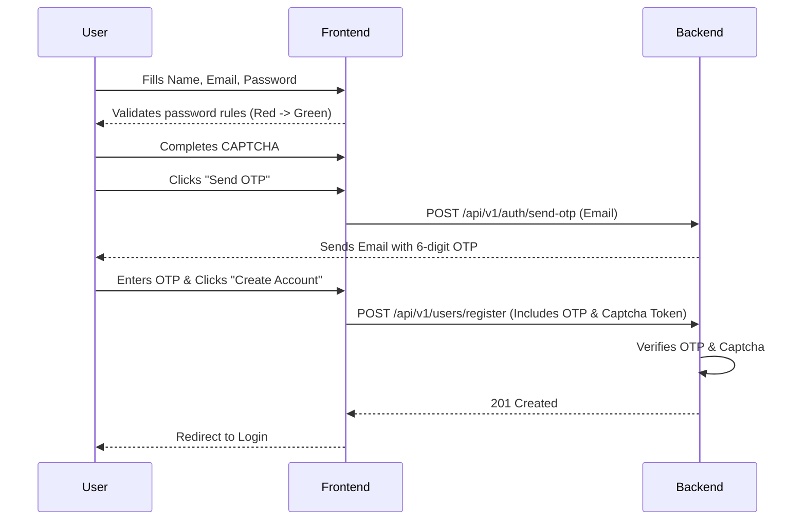

# Enhance Registration Security & UX

This plan outlines the steps to implement CAPTCHA, interactive password rules, and email verification for the BHU Email Portal registration flow.

## Goal Description

The goal is to secure the registration process and improve the user experience by:
1. **Interactive Password Rules**: Displaying specific password requirements (uppercase, lowercase, number, special character) that visually change from red to green as the user types.
2. **CAPTCHA**: Adding a CAPTCHA challenge to prevent automated bot registrations.
3. **Email Verification**: Sending an OTP (One Time Password) to the user's provided alternate email to verify they own it before creating the account.

## User Review Required

> [!IMPORTANT]  
> **CAPTCHA Provider**: For CAPTCHA, we need to choose a provider. Do you want to use **Google reCAPTCHA v2 (Checkbox)**, **Cloudflare Turnstile**, or a **Simple Custom Math Captcha** (e.g., "What is 5 + 3?") to avoid external keys during development?
>
> **Email Sending (SMTP)**: To send real OTP emails, we need an SMTP server (like Gmail App Passwords, SendGrid, or AWS SES). During development, we can just print the OTP to the terminal if you don't have an SMTP server ready. Which approach do you prefer?

## Open Questions

> [!WARNING]  
> **OTP vs. Link**: The plan assumes a **6-digit OTP** sent via email that the user types into the registration form. This provides a smoother UX than a verification link. Is an OTP approach acceptable?

## Proposed Changes

Here is a visual flow of how the new registration will work:

---

### 1. Frontend Modifications

#### [MODIFY] [frontend/src/app/register/page.tsx](file:///c:/Users/Lenovo/OneDrive/Desktop/BHU%20INTERNSHIP%20PROJECT/frontend/src/app/register/page.tsx)
- Add state variables for tracking password conditions (`hasUppercase`, `hasLowercase`, `hasNumber`, `hasSpecialChar`).
- Add a visual checklist under the password input. Example logic:
  - ❌ Minimum 8 characters
  - ✅ One uppercase letter
  - ❌ One lowercase letter
  - ✅ One number
  - ❌ One special character
- Add a state for the registration phase (`phase: 'FORM' | 'OTP'`).
- Add a CAPTCHA widget (e.g., `react-google-recaptcha`) above the submit button.
- Change form submission to first request an OTP. Once requested, show the OTP input field.

#### [NEW] [frontend/src/components/PasswordStrength.tsx](file:///c:/Users/Lenovo/OneDrive/Desktop/BHU%20INTERNSHIP%20PROJECT/frontend/src/components/PasswordStrength.tsx)
- Create a dedicated component for rendering the password rules list to keep the registration page clean.

---

### 2. Backend Modifications

#### [NEW] [backend/src/modules/auth/otp.service.ts](file:///c:/Users/Lenovo/OneDrive/Desktop/BHU%20INTERNSHIP%20PROJECT/backend/src/modules/auth/otp.service.ts)
- Create a service to generate, store (in memory or database), and verify 6-digit OTPs against email addresses.
- Implement a 5-minute expiry for OTPs.

#### [NEW] [backend/src/modules/mail/mail.service.ts](file:///c:/Users/Lenovo/OneDrive/Desktop/BHU%20INTERNSHIP%20PROJECT/backend/src/modules/mail/mail.service.ts)
- Integrate `nodemailer`.
- Add a method `sendVerificationOtp(email, otp)`.

#### [MODIFY] [backend/src/modules/users/dto/create-user.dto.ts](file:///c:/Users/Lenovo/OneDrive/Desktop/BHU%20INTERNSHIP%20PROJECT/backend/src/modules/users/dto/create-user.dto.ts)
- Add `@IsString() otp:` and `@IsString() captchaToken:` to the registration DTO so the backend can validate them during account creation.

#### [MODIFY] [backend/src/modules/users/users.controller.ts](file:///c:/Users/Lenovo/OneDrive/Desktop/BHU%20INTERNSHIP%20PROJECT/backend/src/modules/users/users.controller.ts)
- Add a new endpoint `POST /send-otp` to handle generating and emailing the OTP.
- Update the existing `POST /register` endpoint to first verify the OTP and CAPTCHA token before calling `usersService.register()`.

## Verification Plan

### Manual Verification
1. **Password UX**: Type passwords in the frontend and observe the rule indicators change from red with an 'X' to green with a 'Checkmark'. Registration should be blocked until all rules are green.
2. **CAPTCHA**: Attempt to submit the form without checking the CAPTCHA. The frontend should block it.
3. **OTP Flow**: Enter an email and click submit. Ensure an OTP is generated (and either sent to email or logged to the console).
4. **Invalid OTP**: Enter the wrong OTP and ensure the backend returns a 400 Bad Request.
5. **Successful Registration**: Enter the correct OTP, complete the CAPTCHA, and ensure the account is successfully created in the database.
