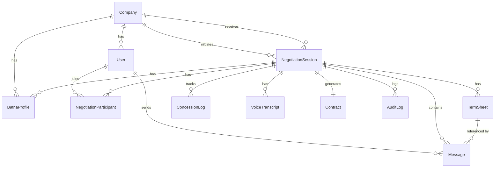
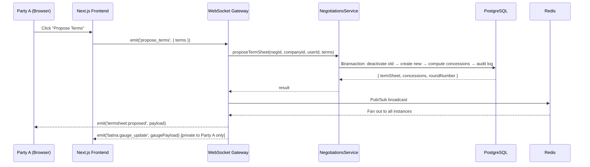

# SCN Negotiator — Complete Codebase Walkthrough & Documentation

> **Project**: Supply Chain Negotiator (SCN)  
> **Type**: Real-time B2B negotiation platform  
> **Architecture**: Monorepo — NestJS Backend + Next.js Frontend  
> **Current Phase**: Phase 1 MVP (core built) → Phase 2 AI (pending)

---

## 1. Project Overview

The **Supply Chain Negotiator** is a real-time, WebSocket-driven platform for B2B commodity trade negotiations. Two companies (initiator & counterparty) negotiate commercial terms (price, delivery, payment, quality) through a live chat room with versioned term sheets, BATNA (Best Alternative to a Negotiated Agreement) gauges, concession tracking, and AI-assisted features.

### Key USPs
| Feature | Description |
|---|---|
| **Real-time Term Sheet Exchange** | Versioned proposals/counter-offers with field-level concession diffs |
| **BATNA Gauge** | Private gauge showing how close the deal is to walk-away price (never leaked to counterparty) |
| **Optimistic Locking** | Race-condition-proof deal acceptance via Redis distributed locks + PostgreSQL version checks |
| **AI Pipelines (Phase 2)** | Sentiment analysis, smart auto-reply counter-offers, voice meeting summarisation |
| **Audit Trail** | Immutable append-only log of every mutation for compliance |

---

## 2. Directory Structure

```
scn-negotiator/
├── backend/                    # NestJS API + WebSocket Server
│   ├── prisma/
│   │   └── schema.prisma       # 11 models, 11 enums — the entire data layer
│   ├── src/
│   │   ├── main.ts             # Bootstrap: CORS, Swagger, ValidationPipe, prefix
│   │   ├── app.module.ts       # Root module: Config, Throttler, Auth, Chat, Negotiations
│   │   ├── swagger.setup.ts    # Swagger UI at /api/v1/docs
│   │   ├── config/
│   │   │   └── configuration.ts  # Typed env validation (class-validator)
│   │   ├── common/
│   │   │   ├── decorators/     # @Public(), @Roles(), @CurrentUser()
│   │   │   ├── filters/        # GlobalExceptionFilter (HTTP + WS)
│   │   │   └── guards/         # JwtAuthGuard, RolesGuard, WsJwtGuard
│   │   ├── shared/
│   │   │   ├── prisma/         # PrismaService (connection pool + graceful shutdown)
│   │   │   ├── redis/          # RedisService (presence, locks, rate limits, Pub/Sub)
│   │   │   └── logger/         # AppLogger (Pino-based structured logging)
│   │   └── modules/
│   │       ├── auth/           # Login, refresh, logout, JWT strategy
│   │       ├── negotiations/   # Session CRUD, term sheet state machine, ACID deal
│   │       ├── chat/           # WebSocket gateway + ChatService
│   │       └── batna/          # BATNA gauge computation service
│   ├── docker-compose.yml      # PostgreSQL 16 + Redis 7
│   ├── Dockerfile              # Multi-stage production build
│   └── package.json            # @scn/backend
│
├── frontend/                   # Next.js 14 App Router
│   ├── src/
│   │   ├── app/
│   │   │   ├── layout.tsx      # Root layout with providers
│   │   │   ├── globals.css     # Global styles
│   │   │   └── negotiations/
│   │   │       └── [id]/       # Dynamic negotiation room page
│   │   ├── components/
│   │   │   ├── negotiation/    # Room UI components
│   │   │   │   ├── NegotiationRoom.tsx
│   │   │   │   ├── NegotiationTopBar.tsx
│   │   │   │   ├── RightPanel.tsx
│   │   │   │   ├── chat/       # Chat panel components
│   │   │   │   ├── term-sheet/ # Term sheet display/form
│   │   │   │   ├── batna/      # BATNA gauge SVG
│   │   │   │   ├── concessions/# Concession tracker
│   │   │   │   └── ui/         # Shared UI primitives
│   │   │   └── providers/      # ReactQueryProvider
│   │   ├── hooks/
│   │   │   └── useNegotiationSocket.ts  # Socket.io lifecycle hook (614 lines)
│   │   ├── lib/
│   │   │   ├── negotiation-math.ts      # Pure math functions (787 lines, 100% tested)
│   │   │   └── utils.ts                 # Formatting helpers
│   │   └── stores/
│   │       └── useNegotiationStore.ts   # Zustand central store (1116 lines)
│   └── package.json            # @scn/frontend
│
├── shared/                     # Cross-project types
│   └── types/
│       └── index.ts            # Enums, WS event names, DTOs (189 lines)
│
└── docs/
    ├── architecture/
    │   ├── phase1-core-architecture.md   # Mermaid diagram
    │   └── phase2-ai-integration.md      # Sequence diagram
    └── phase-2-ai-specification.md       # 815-line AI integration brief
```

---

## 3. Technology Stack

### Backend
| Technology | Purpose |
|---|---|
| **NestJS 10** | DI framework, modules, guards, pipes, WebSocket gateway |
| **Prisma 5** | ORM with PostgreSQL, type-safe queries, migrations |
| **PostgreSQL 16** | Primary data store, SERIALIZABLE transactions |
| **Redis 7** | Presence tracking, distributed locks (SET NX), rate limiting, Pub/Sub |
| **Socket.io 4** | WebSocket server with Redis adapter for horizontal scaling |
| **Passport + JWT** | Authentication (access 15m + refresh 7d token pair) |
| **bcryptjs** | Password hashing (12 rounds) |
| **Pino** | Structured JSON logging |
| **Swagger/OpenAPI** | API documentation at `/api/v1/docs` |

### Frontend
| Technology | Purpose |
|---|---|
| **Next.js 14** | App Router, SSR, dynamic routing |
| **React 18** | UI rendering |
| **Zustand 4** | Central state management (single store, 1116 lines) |
| **TanStack React Query 5** | Server state / API caching |
| **Socket.io Client** | WebSocket connection to backend gateway |
| **Radix UI** | Accessible headless components (Dialog, Tabs, Toast, etc.) |
| **TailwindCSS 3** | Utility-first styling |
| **Zod + React Hook Form** | Form validation |
| **Lucide React** | Icons |

---

## 4. Database Schema (11 Models)



### Model Summary

| # | Model | Purpose | Key Fields |
|---|---|---|---|
| 1 | **Company** | Organizations on the platform | slug, tier (STARTER/GROWTH/ENTERPRISE), KYC |
| 2 | **User** | Individual users | email, passwordHash (bcrypt-12), role, refreshTokenHash |
| 3 | **NegotiationSession** | Root negotiation entity | status, phase, version (optimistic lock), BATNA prices, AI fields |
| 4 | **NegotiationParticipant** | User ↔ Negotiation join table | isLead, canAcceptDeal, isOnline |
| 5 | **Message** | Chat log entries | type (9 variants), sentiment fields, AI fields, clientTempId |
| 6 | **TermSheet** | Versioned commercial proposals | 20+ commercial fields, status lifecycle, AI counter-suggestion |
| 7 | **BatnaProfile** | Private reserve/target prices | reservePrice (NEVER leaked), targetPrice, priority weights |
| 8 | **ConcessionLog** | Field-level diffs per round | termField, previousValue, newValue, deltaPercent |
| 9 | **VoiceTranscript** | Meeting recordings + AI summaries | rawTranscript, aiSummary, aiKeyPoints, aiActionItems |
| 10 | **Contract** | Generated contract documents | documentUrl, e-signature fields |
| 11 | **AuditLog** | Immutable mutation trail | action, entityType, previousState, newState |

### Key Enums
- **NegotiationStatus**: `DRAFT → PENDING → ACTIVE → IN_REVIEW → ACCEPTED/REJECTED/EXPIRED → COMPLETED`
- **NegotiationPhase**: `OPENING → EXPLORATORY → BARGAINING → CLOSING → SIGNATURE`
- **TermStatus**: `PROPOSED → COUNTERED/AGREED/REJECTED`
- **MessageSentiment**: `STRONGLY_AGGRESSIVE → AGGRESSIVE → NEUTRAL → YIELDING → STRONGLY_YIELDING → UNCLASSIFIED`
- **IncotermsCode**: All 11 ICC Incoterms (EXW, FOB, CIF, DDP, etc.)
- **CurrencyCode**: USD, EUR, GBP, JPY, CNY, INR, SGD, AED, CAD, AUD

---

## 5. Backend Architecture Deep-Dive

### 5.1 Authentication Flow (`modules/auth/`)

```
Login → bcrypt.compare (constant-time) → check UserStatus → issue token pair
  ├── Access Token:  15min, signed with JWT_SECRET
  └── Refresh Token: 7 days, signed with JWT_REFRESH_SECRET (stored as bcrypt hash in DB)

Refresh → compare token against stored hash → if mismatch: REUSE DETECTION → clear all sessions
Logout → clear refreshTokenHash → AT expires naturally (15m)
```

> [!IMPORTANT]
> **Refresh token reuse detection**: If a mismatched refresh token is submitted, ALL sessions for that user are invalidated immediately. This protects against stolen tokens.

### 5.2 Negotiations Service (`modules/negotiations/`)

The core business logic engine with these operations:

| Operation | Description | Transaction |
|---|---|---|
| `createSession()` | Creates session + BATNA profile + participant + audit log | `$transaction` |
| `proposeTermSheet()` | Creates new version, deactivates previous, computes concessions | `$transaction` |
| `counterTermSheet()` | Marks previous as COUNTERED, creates counter with merged fields | `$transaction` |
| `acceptTermSheet()` | Marks as AGREED, evaluates phase transition | Caller-managed TX |
| `rejectTermSheet()` | Marks as REJECTED with reason | `$transaction` |
| `acceptDeal()` | **ACID critical path** — optimistic version lock + final deal | Caller-managed SERIALIZABLE TX |

### 5.3 WebSocket Gateway (`modules/chat/negotiation.gateway.ts`)

The 988-line gateway is the real-time heart of the system:

```
Architecture:
  Client A ←→ [Socket.io Server Instance 1] ←→ [Redis Pub/Sub] ←→ [Instance 2] ←→ Client B
```

**18 Client → Server events:**
`join_negotiation`, `leave_negotiation`, `send_message`, `propose_terms`, `counter_terms`, `accept_terms`, `reject_terms`, `accept_deal`, `typing_start`, `typing_stop`, `heartbeat`

**15 Server → Client events:**
`negotiation:joined`, `negotiation:left`, `negotiation:presence_update`, `message:new`, `message:sentiment_update`, `message:ai_suggestion`, `termsheet:proposed`, `termsheet:countered`, `termsheet:agreed`, `termsheet:rejected`, `negotiation:phase_change`, `negotiation:deal_accepted`, `batna:gauge_update`, `typing:start`, `typing:stop`

> [!WARNING]
> **Race condition protection on `accept_terms` and `accept_deal`**:
> 1. Redis distributed lock (`SET NX`) prevents concurrent execution
> 2. PostgreSQL SERIALIZABLE isolation prevents write skew
> 3. Optimistic version check (`WHERE version = :expected`) as final safety net

### 5.4 BATNA Service (`modules/batna/`)

Computes the real-time gauge showing how close the current deal is to the party's private walk-away price:

```
Zone Classification:
  DANGER     → price past reserve (walk-away territory)
  CAUTION    → 0-10% of reserve-to-target range
  ACCEPTABLE → 10-80%
  OPTIMAL    → ≥80% toward target

Privacy: reservePrice and targetPrice are NEVER transmitted — only derivative values
```

### 5.5 Infrastructure Services

| Service | Responsibilities |
|---|---|
| **PrismaService** | Connection pool, `$connect()/$disconnect()`, `executeInTransaction(SERIALIZABLE)` |
| **RedisService** | `withLock()`, `addUserToRoom/removeUserFromRoom`, `checkMessageRateLimit` (60/min), `getOnlineUsers`, `refreshPresence`, publisher/subscriber for Pub/Sub adapter |
| **AppLogger** | Pino structured JSON logging with request context |

---

## 6. Frontend Architecture Deep-Dive

### 6.1 Zustand Store (1116 lines)

The `useNegotiationStore` is the single source of truth for all negotiation room UI state:

| State Group | Key Fields |
|---|---|
| **Session** | `session`, `participants` |
| **Messages** | `messages[]`, `hasMoreMessages`, cursor pagination |
| **Term Sheets** | `activeTermSheet`, `termSheetHistory[]`, `priceTicker`, `highlightedTermField` |
| **BATNA** | `batnaProfile`, `batnaGauge` (zone, percentageToTarget) |
| **Concessions** | `concessionRounds[]` with per-round summaries |
| **Presence** | `onlineUserIds` (Set), `typingUsers[]` |
| **Connection** | `connectionStatus` (connecting/connected/reconnecting/disconnected/error) |
| **UI** | `rightPanelTab`, `chatInputValue`, `pendingActionType`, `toasts[]` |

**Optimistic UI pattern**: Messages are added immediately with `isPending: true`, then reconciled against the server-confirmed message via `clientTempId` matching.

### 6.2 Socket Hook (614 lines)

`useNegotiationSocket` manages the full WebSocket lifecycle:
- Creates socket on mount, authenticates via `handshake.auth.token`
- Registers all 18 server event handlers → maps to Zustand actions
- Provides stable action callbacks: `sendMessage`, `proposeTerms`, `counterTerms`, `acceptTerms`, `rejectTerms`, `acceptDeal`, `sendTypingStart`, `sendTypingStop`
- 30s heartbeat interval for presence keepalive
- Auto-reconnection (10 attempts, exponential backoff up to 30s)
- 10s timeout-based failure detection for optimistic messages

### 6.3 Negotiation Math (787 lines)

Pure, tested calculation functions grouped by domain:

| Domain | Functions |
|---|---|
| **Deal Valuation** | `calculateDealValue`, `calculateGrossMarginPercent`, `calculateMarginPerUnit`, `calculateTotalMargin` |
| **Price Viability** | `isPriceViable` (margin threshold check) |
| **BATNA Gauge** | `computeBatnaGauge` (client-side equivalent of backend service) |
| **Concession Tracking** | `diffTermSheets`, `sumConcessionValue`, `whoConcededMore` |
| **Payment Valuation** | `estimatePaymentTermsCost` (implicit financing cost) |
| **Price Ticker** | `computePriceTicker` (direction + magnitude badge) |
| **Penalty** | `calculateLatePenalty` (pro-rated weekly penalty) |
| **Version Safety** | `isVersionFresh` (client-side optimistic lock pre-check) |

---

## 7. Data Flow Diagram



---

## 8. Phase 2: AI Integration (What Needs to Be Done)

> [!NOTE]
> The Phase 1 MVP was **deliberately architected** so that all AI fields, DB columns, WS events, and frontend handlers are already in place. Phase 2 activates them — no schema migrations needed.

### 8.1 Feature 1: AI Sentiment Analysis

| Aspect | Status |
|---|---|
| DB fields on Message model | ✅ Already exists (sentiment, score, confidence, model, raw response) |
| Trigger point in `chat.service.ts` | ✅ Stub exists — needs Anthropic SDK call |
| WS event `message:sentiment_update` | ✅ Already wired in frontend |
| Frontend `updateMessageSentiment()` | ✅ Already in Zustand store |
| **New file needed** | `src/modules/ai/sentiment/ai-sentiment.service.ts` |
| **LLM model** | Claude Sonnet (classifies tone → 5 categories, -1.0 to +1.0 score) |

### 8.2 Feature 2: Smart Auto-Reply Counter-Offers

| Aspect | Status |
|---|---|
| DB fields on TermSheet | ✅ `aiCounterSuggestion`, `aiCounterSuggestionModel`, `aiCounterSuggestionAt` |
| Trigger condition in `chat.service.ts` | ✅ `shouldTriggerAutoReply()` already implemented |
| WS event `message:ai_suggestion` | ✅ Already wired in frontend |
| Frontend `addAiSuggestion()` | ✅ Already in Zustand store |
| **New files needed** | `ai-auto-reply.service.ts`, `ai-context.assembler.ts` |
| **Privacy** | `reservePrice` is explicitly excluded from LLM context |

### 8.3 Feature 3: Voice Meeting Summarisation

| Aspect | Status |
|---|---|
| VoiceTranscript model | ✅ Complete (rawTranscript, aiSummary, aiKeyPoints, aiActionItems) |
| Upload endpoint | ✅ In negotiations controller (needs trigger activation) |
| **New files needed** | `ai-voice.service.ts` |
| **STT provider** | OpenAI Whisper API (optional pre-processing if audio URL provided) |

### 8.4 New Module Structure for Phase 2

```
src/modules/ai/
├── ai.module.ts                         # NestJS module
├── sentiment/
│   ├── ai-sentiment.service.ts          # LLM tone classification
│   └── ai-sentiment.service.spec.ts
├── auto-reply/
│   ├── ai-auto-reply.service.ts         # Context assembly + counter-offer generation
│   ├── ai-context.assembler.ts          # Pure context builder (excludes reservePrice)
│   └── ai-auto-reply.service.spec.ts
└── voice/
    ├── ai-voice.service.ts              # STT + LLM summarisation
    └── ai-voice.service.spec.ts
```

### 8.5 Environment Variables for Phase 2

```env
ANTHROPIC_API_KEY=sk-ant-...
OPENAI_API_KEY=sk-...              # For Whisper STT
AI_SENTIMENT_ENABLED=true
AI_AUTO_REPLY_ENABLED=true
AI_VOICE_ENABLED=true
AI_MAX_CONCURRENT_JOBS=10
AI_RETRY_MAX_ATTEMPTS=3
AI_RETRY_BASE_DELAY_MS=1000
```

---

## 9. Remaining Work Checklist

### Phase 2 — AI Integration (Primary)

- [ ] Create `src/modules/ai/ai.module.ts` and register in AppModule
- [ ] Implement `AiSentimentService` with Anthropic SDK call
- [ ] Activate `triggerSentimentAnalysis()` stub in `chat.service.ts`
- [ ] Implement session aggregate sentiment (`overallSentimentScore` rolling average)
- [ ] Implement `AiAutoReplyService` with context assembler
- [ ] Implement `AiVoiceService` with STT pre-processing
- [ ] Add `voice_transcript:summarized` WS handler in frontend
- [ ] Wire "Apply Suggestion" button in MessageBubble to `setTermSheetDraft()`
- [ ] Add `withAIFallback()` error wrapper for graceful degradation
- [ ] Write unit tests with mocked LLM responses
- [ ] Write integration tests for full AI pipeline flow

### Infrastructure & DevOps

- [ ] Run `prisma migrate dev` to apply schema to database
- [ ] Seed database with test companies, users, and sample negotiations
- [ ] Configure production Docker deployment (uncomment backend service in docker-compose)
- [ ] Set up CI/CD pipeline (lint → test → build → deploy)
- [ ] Configure production environment variables (real JWT secrets, API keys)
- [ ] Set up monitoring and alerting (Pino → log aggregator)

### Frontend Completion

- [ ] Build the negotiations list/dashboard page (currently only room page exists)
- [ ] Add user registration and login pages
- [ ] Implement the "Create Negotiation" wizard flow
- [ ] Add invite counterparty flow (session goes DRAFT → PENDING → ACTIVE)
- [ ] Build the contract generation view (post-deal acceptance)
- [ ] Add analytics/reporting dashboard
- [ ] Mobile responsiveness pass
- [ ] Accessibility audit (Radix UI provides the foundation)

### Testing

- [ ] Backend unit tests for all services (80%+ coverage target defined in package.json)
- [ ] Backend integration tests (Vitest config exists)
- [ ] Frontend component tests (@testing-library/react configured)
- [ ] Frontend store tests (Zustand + Vitest)
- [ ] E2E tests with Playwright (dependency installed)
- [ ] Load testing for WebSocket concurrent connections

### Phase 3 (Future)

- [ ] Replace inline AI workers with BullMQ + Redis job queues
- [ ] Add LiteLLM proxy for multi-provider LLM routing
- [ ] Implement SSO (domain-based company matching)
- [ ] Add 2FA (TOTP fields already in User model)
- [ ] Stripe billing integration (stripeCustomerId field exists on Company)
- [ ] E-signature integration (DocuSign/HelloSign — Contract fields exist)
- [ ] Full-text search on negotiation history (Prisma `fullTextSearch` preview enabled)

---

## 10. How to Run Locally

```bash
# 1. Start infrastructure
cd backend
docker-compose up -d postgres redis

# 2. Configure environment
cp .env.local .env   # Already has dev defaults

# 3. Generate Prisma client + migrate
npm run prisma:generate
npm run prisma:migrate

# 4. Start backend (port 3001)
npm run start:dev

# 5. Start frontend (port 3000)
cd ../frontend
npm run dev
```

**Endpoints:**
- Frontend: `http://localhost:3000`
- Backend API: `http://localhost:3001/api/v1/`
- Swagger Docs: `http://localhost:3001/api/v1/docs`
- WebSocket: `ws://localhost:3001/negotiations`
- Prisma Studio: `npx prisma studio` (port 5555)
